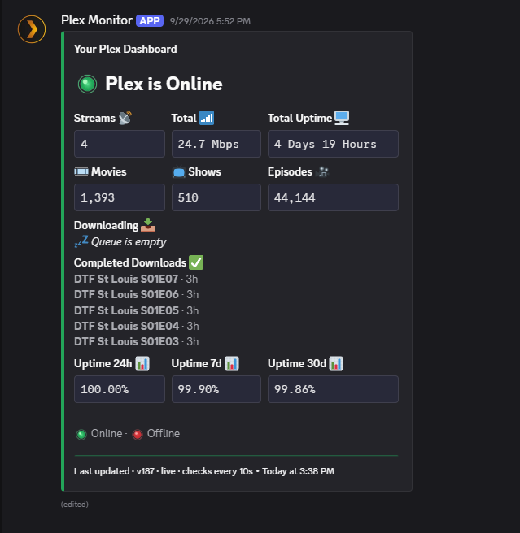
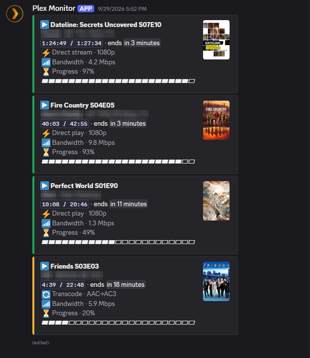
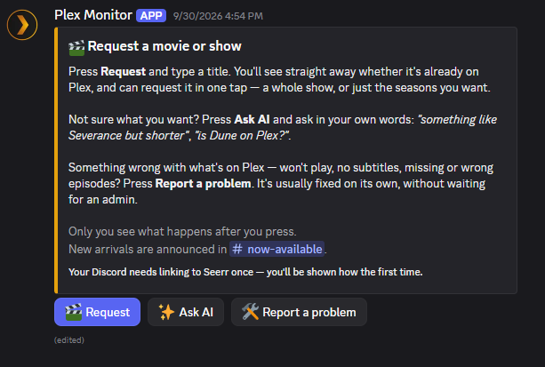
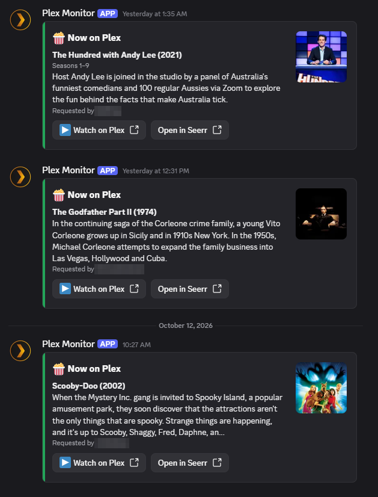

# PlexMonitor

A Discord bot for your Plex server. It keeps a live status dashboard in a channel,
shows who's watching what, and lets your friends request movies and shows through
Seerr — with an optional AI assistant for "what should I watch?" questions.

<table>
  <tr>
    <td width="50%"></td>
    <td width="50%"></td>
  </tr>
  <tr>
    <td align="center"><b>Status dashboard</b></td>
    <td align="center"><b>Stream cards</b></td>
  </tr>
  <tr>
    <td width="50%"></td>
    <td width="50%"></td>
  </tr>
  <tr>
    <td align="center"><b>Request panel</b></td>
    <td align="center"><b>"Now on Plex" posts</b></td>
  </tr>
</table>

## Features

- **Live dashboard.** One message that stays up to date: online or offline,
  active streams and bandwidth, library counts, uptime, downloads in progress
  and recently finished, and reliability over 24 hours, 7 days and 30 days.
- **Stream cards.** One card per stream, with the poster, a progress bar, the
  player, and whether it's direct playing or transcoding (and why). The cards
  can sit under the dashboard or in a channel of their own.
- **Instant updates.** With Tautulli's webhook, the dashboard refreshes within
  seconds when someone presses play, pause or stop.
- **Real uptime.** Uptime is tracked across restarts, and the bot can read your
  real outage history from Uptime Kuma 2.x or UptimeRobot.
- **Downloads.** SABnzbd's queue, plus what Radarr and Sonarr just imported,
  under their proper titles.
- **Request panel.** A pinned message with a **Request** button. Type a title
  to see whether it's already on Plex, then request it in one tap: a whole show
  or just the seasons you want. Requests go through Seerr as the person
  asking, so their own permissions, quotas and auto-approval apply.
- **"Now on Plex" posts.** When a request becomes available, the bot posts it
  with the poster, a **Watch on Plex** button, and who asked for it.
- **Report a problem.** A button on the panel (or `/issue`) files a Seerr
  issue for something on Plex that won't play, has bad sound or subtitles, or
  is missing episodes. With Seerr AI, most of these fix themselves.
- **Private AI assistant.** Ask in plain words ("something like Severance but
  shorter?"). The answer is visible only to the person who asked, and each
  suggestion comes with a Request or Watch on Plex button. The answers come
  from [Seerr AI](https://github.com/corruptmods/seerrai)'s own AI, or from
  Claude, OpenAI or a local model (Ollama, LM Studio) through the bot itself.
  Only members of your server can use it.
- **`/recap`.** A spoiler-free "previously on" up to where you are in a show
  (needs Seerr AI).
- **Bot status.** The bot's status shows the number of active streams, or your
  library sizes when nobody is watching.

Every integration except Discord and Plex is optional. Leave its settings blank
and that feature switches off cleanly.

## Requirements

- Docker with Docker Compose (or a Compose manager like Dockge or Portainer)
- A Discord bot token. [SETUP.md](SETUP.md#1b-creating-the-discord-bot) walks
  through creating one; no privileged intents are needed.
- Plex, with [Tautulli](https://tautulli.com) recommended

Optional:

- [Seerr](https://github.com/seerr-team/seerr) for requests, `/issue` and
  "Now on Plex" posts. [Seerr AI](https://github.com/corruptmods/seerrai)
  isn't required: it only adds its own AI answers, `/recap`, and automatic
  fixes for reported problems. With plain
  Seerr the assistant uses the bot's own AI model, if you give it one.
- SABnzbd, Radarr and Sonarr for downloads
- Uptime Kuma 2.x or UptimeRobot for uptime
- A Claude or OpenAI API key, or a local model, for the assistant

## Quick start

```bash
git clone https://github.com/corruptmods/plexmonitor.git
cd plexmonitor
cp .env.example .env
nano .env        # at least DISCORD_TOKEN, CHANNEL_ID, and Tautulli or Plex
docker compose up -d --build
```

The bot posts its dashboard in `CHANNEL_ID` within a minute. Settings live in
`.env` (credentials and channels) and `data/config.json` (everything else,
created on first start and reloaded on the fly). [SETUP.md](SETUP.md) covers
every option.

### Updating

```bash
git pull
docker compose up -d --build
```

Your `.env` and `data/` folder are never touched by an update.

## Commands

| Command | Who | What it does |
|---|---|---|
| `/issue` | Everyone | Report a problem with something on Plex to Seerr |
| `/recap` | Everyone | Spoiler-free recap of a show up to where you are (Seerr AI) |
| `/link`, `/unlink` | Bot admins | Link someone's Discord account to their Seerr account |
| `/emojis`, `/statusdots` | Everyone | List this server's emoji with the tags to paste into `data/config.json` (only the person who ran it sees the list) |
| `/load`, `/unload`, `/reload`, `/cogs` | Bot admins | Manage the bot's modules without a restart |

Requesting and the assistant are buttons on the request panel, so there is no
request command. "Bot admins" are the user IDs in `DISCORD_AUTHORIZED_USERS`,
or the bot's owner when that's empty.

## Credits

PlexMonitor started as a fork of
[nichtlegacy/PlexMonitor](https://github.com/nichtlegacy/PlexMonitor) (MIT) and
has since been largely rewritten: a new dashboard and stream cards, Tautulli as
the main data source, real uptime tracking, Uptime Kuma 2.x and UptimeRobot
support, Radarr and Sonarr history, and the Seerr requests and AI features.

This project isn't affiliated with Plex, Discord, Seerr or Tautulli.

## License

[MIT](LICENSE)
